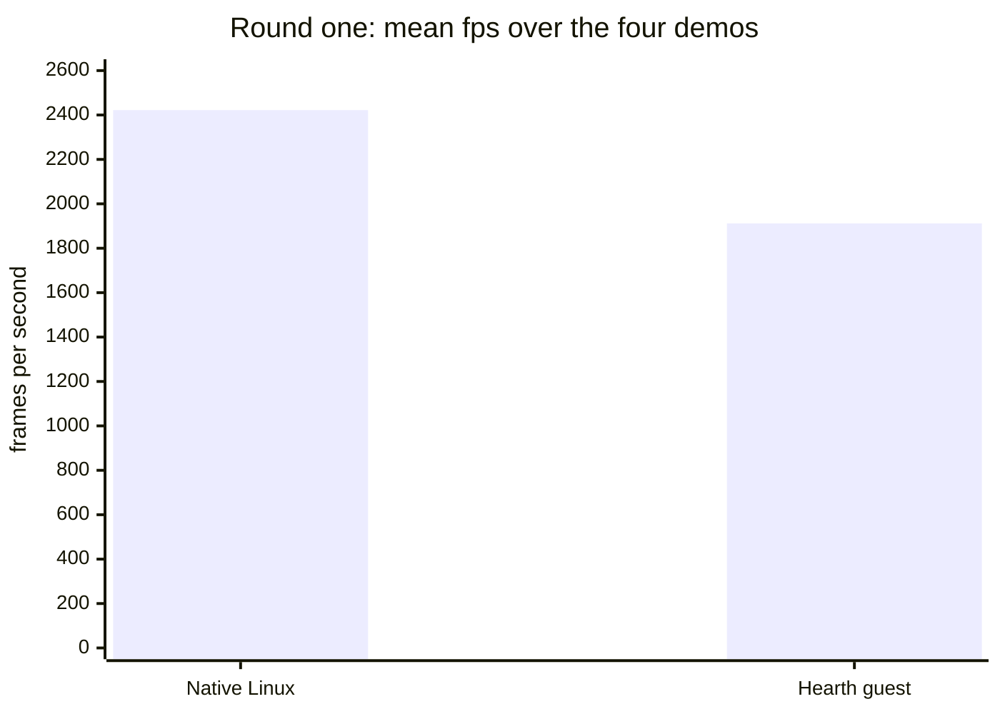
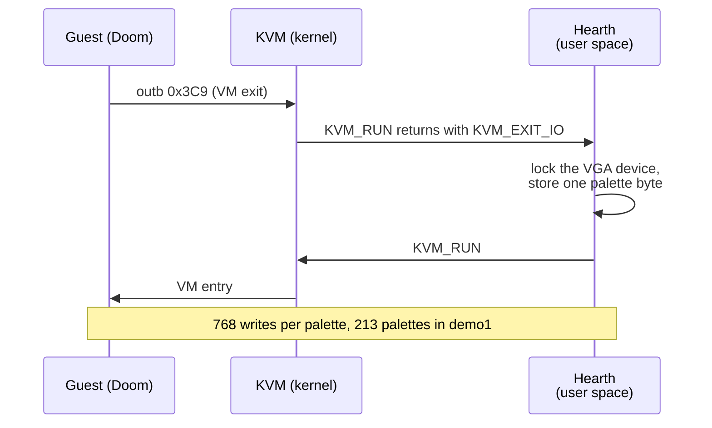
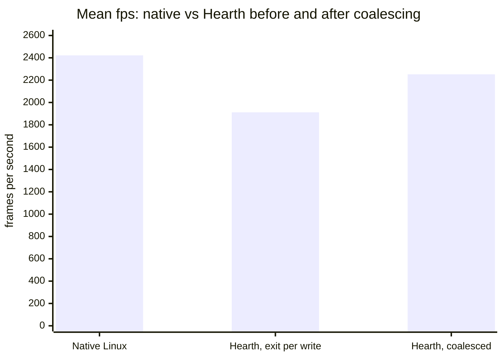
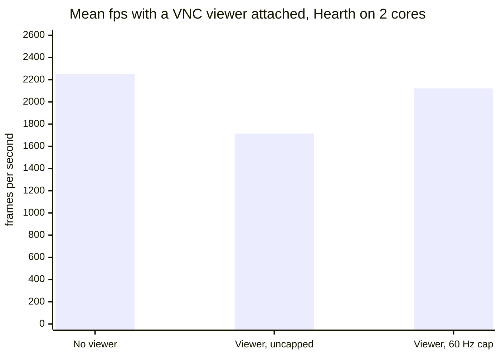
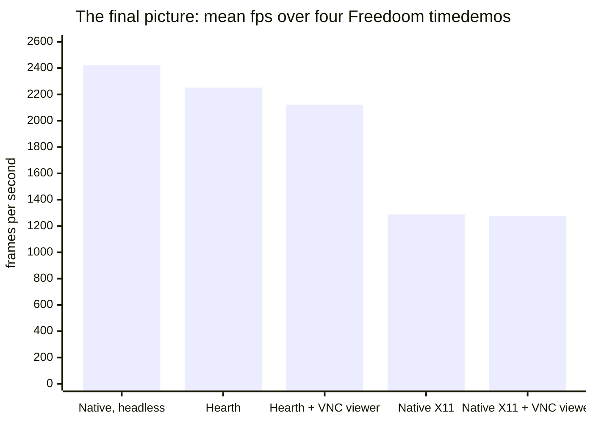



## Meet Hearth

Hearth is a virtual machine monitor (VMM) I have been writing from scratch in
Rust, on top of Linux KVM. KVM does the hard part, running guest code on the
real CPU. Everything else is Hearth: guest memory, loading and booting kernels,
and every device the guest talks to.

## Doom as the guest

This is not Doom running on Linux inside a VM. Doom *is* the guest:
[doomgeneric](https://github.com/ozkl/doomgeneric) is linked with a tiny libc
and a PVH entry stub into one ELF and Hearth boots it like a kernel.

There is no BIOS to call, so the guest programs the VGA registers for mode 13h
one by one. From then on a frame is just memory: 320×200 bytes of palette
indices at `0xA0000`. On the Hearth side that framebuffer is plain guest RAM,
so drawing costs no exits at all. Only the VGA registers are trapped. So the
guest-side code for drawing a frame now looks like:

```c
void DG_DrawFrame(void)
{
	if (palette_changed) {
		/* ... */
		vga_set_palette(rgb);
		palette_changed = false;
	}
	memcpy(VGA_FRAMEBUFFER, DG_ScreenBuffer, VGA_WIDTH * VGA_HEIGHT);
}
```

### How fast is it?

Doom has a built-in benchmark, `-timedemo demo1`, which plays a recorded demo as
fast as possible and reports frames per second. Freedoom ships four demos. For
a fair comparison against native Linux, I built the same doomgeneric revision
with the same `-O2 -DCMAP256` configuration and 320×200 resolution, using a
headless platform layer that does the same 64,000-byte frame copy and never
displays it.

I ran each demo three times per configuration, pinned to the same logical CPU
of my laptop's Intel Core i5-7200U (Kaby Lake, 2 cores and 4 threads), and
averaged the results.

One gotcha for anyone repeating this: on Linux, Doom's `I_Error` shows a zenity
dialog, and `-timedemo` reports its result through `I_Error`. Without `-nogui`,
the benchmark waits for you to click OK.

Round one:

| fps | demo1 | demo2 | demo3 | demo4 | **mean** |
|---|---|---|---|---|---|
| Native Linux (headless) | 2778 | 2830 | 2258 | 1819 | **2422** |
| Hearth guest | 1936 | 2348 | 1818 | 1546 | **1912** |



21% slower, and up to 31% slower on demo1. Doom's work is plain CPU work, which
a VM should run at nearly full speed, so something was off. I also expected
a much greater speed-up due to absence of syscalls: Doom is the kernel here,
remember?

## Investigating the slowdown

The guest isn't built quite like the native binary, so I took those differences
away one at a time:

| Native build | mean fps |
|---|---|
| Its own flags and glibc | 2422 |
| The guest's freestanding flags (`-ffreestanding -fno-pie -mno-red-zone -mcmodel=small ...`) | 2408 |
| ...and the guest's `rep movsb` / `rep stosb` `memcpy` and `memset` | 2397 |

Neither the compiler flags nor the guest's `libc` explain it.

### Counting exits

The useful question was: how often does the guest leave guest mode and come back
to Hearth? `strace` counted about 169,600 `ioctl` calls for one run of demo1,
nearly all of them `KVM_RUN`: about 24 per frame. A throwaway build that counted
exits by port told the rest:

| demo | exits to Hearth | writes to port 0x3C9 (VGA DAC data) | palette loads |
|---|---|---|---|
| demo1 | 169,280 | 163,584 | 213 |
| demo2 | 79,307 | 73,728 | 96 |
| demo3 | 94,687 | 89,088 | 116 |
| demo4 | 50,025 | 44,544 | 58 |

So, for demo1, the 169,280 exits were VGA DAC data (163,584 exits), serial
port I/O (5,326 exits), and everything else: just 370 exits.

So, the culprit is definitely the VGA palette. The VGA DAC takes a palette one
byte per port write and Doom reloads all 256 colours on every tic of the red
damage flash or the gold pickup flash:

```c
void vga_set_palette(const uint8_t rgb[256][3])
{
	outb(VGA_DAC_WRITE_INDEX, 0);
	for (int i = 0; i < 256; i++) {
		outb(VGA_DAC_DATA, rgb[i][0] >> 2);
		outb(VGA_DAC_DATA, rgb[i][1] >> 2);
		outb(VGA_DAC_DATA, rgb[i][2] >> 2);
	}
}
```

That's 768 `outb`s per palette. Under KVM each one is a full round trip:



The extra time per demo follows the number of DAC writes closely:

| demo | DAC writes | Hearth's extra time vs native |
|---|---|---|
| demo4 | 44,544 | +0.30 s |
| demo2 | 73,728 | +0.51 s |
| demo3 | 89,088 | +0.65 s |
| demo1 | 163,584 | +1.11 s |

That gives **about 7 µs per exit**.

### The coalesced PIO speed-up

KVM has a feature for exactly this: **coalesced MMIO**, which also covers port
I/O since Linux 4.20 (`KVM_CAP_COALESCED_PIO`). You register a range of ports,
and for writes into it KVM appends `{port, length, data}` to a ring buffer
shared with the VMM and goes straight back to the guest, without returning from
`KVM_RUN`. Reads still exit normally, and so does a write that finds the ring
full.

Hearth registers the two DAC write ports, `0x3C8` and `0x3C9`. The ring then
only ever holds VGA writes, so the VGA device itself drains it, in order, before
any other register access and before rendering a frame:

```rust
fn apply_queued_writes(&mut self) {
    let Some(ring) = self.dac_writes.take() else { return };
    ring.drain(|port, data| {
        // This path handles the one-byte PIO writes used by the VGA DAC.
        for (i, &byte) in data.iter().enumerate() {
            self.write(port as u16 + i as u16, byte);
        }
    });
    self.dac_writes = Some(ring);
}
```

Two details make this safe. Any VGA register access first drains the ring, so a
guest that writes the DAC and then reads it back sees its writes in order. And
when the ring fills (it has room for 169 writes), KVM falls back to a normal
exit, which the device again handles only after draining the ring. The guest
doesn't change at all: it is still the standard VGA DAC, written one `outb` at
a time.

| fps | demo1 | demo2 | demo3 | demo4 | **mean** | vs native |
|---|---|---|---|---|---|---|
| Native Linux (headless) | 2778 | 2830 | 2258 | 1819 | **2422** | |
| Hearth, an exit per DAC write | 1936 | 2348 | 1818 | 1546 | **1912** |  21% |
| Hearth, coalesced DAC writes | 2508 | 2678 | 2080 | 1742 | **2252** |  7% |



### Why there is still a gap

The remaining overhead still scales with the number of DAC writes, now at
**about 1.7 µs per write**:

| demo | DAC writes | extra time, before | extra time, after |
|---|---|---|---|
| demo4 | 44,544 | +0.30 s | +0.08 s |
| demo2 | 73,728 | +0.51 s | +0.14 s |
| demo3 | 89,088 | +0.65 s | +0.23 s |
| demo1 | 163,584 | +1.11 s | +0.28 s |

On this Intel VMX setup, each trapped `out` instruction still causes a VM exit
into the host kernel. Coalescing avoids the additional trip into userspace for
eligible writes, but it does not eliminate the guest-to-host transition itself.

On this Kaby Lake CPU, the remaining cost may also include speculative-execution
mitigations that the kernel applies when switching between guest and host:

- **Spectre v2 (IBRS):** older CPUs need a model-specific register written on
every switch between guest and host.
- **MDS and stale MMIO data:** the CPU's internal buffers are cleared before
every return to the guest.
- **L1TF:** with `vmentry_l1d_flush=cond`, KVM may flush the L1 data cache
before re-entering the guest, which then runs on a cold cache.

The exact cost depends on the CPU, microcode, kernel configuration, and active
mitigations. Newer CPUs address some of these issues in hardware, so the same
exit can cost less there.

## An experiment I didn't ship: the palette in memory

Mode 13h uses 64,000 bytes of VGA's 64 KiB window, so 1,536 bytes at `0xAFA00`
go unused. As an experiment, the guest wrote a magic `PAL6` and its 768-byte
palette there with one `memcpy`, and Hearth read it before each frame. No port
writes at all:

| fps | mean | vs native |
|---|---|---|
| Hearth, palette in memory | 2371 |  2% |

That closes nearly the whole gap. But it's a private convention between this
guest and this VMM, which no real VGA card has: Doom built this way would show
wrong colours anywhere else and Hearth would have to trust unused video memory.
The standard path, at 7% below native, is the one that stayed.

## Benchmarking with VNC viewer

Benchmarks without a display are one thing, but people watch Doom. With a VNC
client streaming frames for the whole run, the committed build looked like this:

| fps, viewer attached | demo1 | demo2 | demo3 | demo4 | **mean** | updates per run |
|---|---|---|---|---|---|---|
| Hearth on 2 cores | 1667 | 1852 | 1808 | 1532 | **1715** | 992 |
| Hearth on 1 core | 2218 | 2371 | 1867 | 1591 | **2012** | 325 |

A quarter of the speed was gone, and two cores did worse than one. The VNC
server answered each request for an update immediately. Viewers ask for the next
frame as soon as they get one, so the server rendered around 300 frames a
second. Each render takes the VGA device's lock and drains the coalesced ring.
Doing that on the other core while the vCPU keeps writing into the ring most
likely explains why two cores did worse than one. A 60 Hz display can show at
most 60 new frames per second.

The fix is a few lines in the update loop: don't render more often than every
`1/60` s. An update requested after a quiet period is still answered
immediately.

```rust
let wait = if pending { next_render.saturating_duration_since(Instant::now()) } else { UPDATE_INTERVAL };
match rx.recv_timeout(wait) {
    // ...
}
if !pending || Instant::now() < next_render {
    continue;
}

/* An incremental request waits until something changes. */
next_render = Instant::now() + UPDATE_INTERVAL;
```

| fps, viewer attached | demo1 | demo2 | demo3 | demo4 | **mean** | updates per run |
|---|---|---|---|---|---|---|
| Hearth on 2 cores, uncapped | 1667 | 1852 | 1808 | 1532 | **1715** | 992 |
| Hearth on 2 cores, 60 Hz cap | 2380 | 2515 | 1953 | 1638 | **2122** | 139 |
| Hearth on 1 core, uncapped | 2218 | 2371 | 1867 | 1591 | **2012** | 325 |
| Hearth on 1 core, 60 Hz cap | 2267 | 2465 | 1946 | 1663 | **2085** | 143 |



A viewer now costs 6% instead of 24%, and the runs became steady. demo2 used to
range from 1,723 to 2,085 fps across runs and now stays within 2,506 to 2,532.

### And the dirty log earns its keep

While at it, I checked whether KVM's dirty-page log is worth having. Without it,
every frame counts as fully changed, so the VNC thread converts and sends all
200 rows every time. These runs used the in-memory palette build from the
experiment above, so compare them with each other, not with the other tables:

| mean fps | dirty log | no dirty log |
|---|---|---|
| No viewer | 2371 | 2375 |
| Viewer, Hearth on 2 cores | 2161 | 2100 |
| Viewer, Hearth on 1 core | 2212 | **1347** |

With no viewer the log costs nothing. Hearth only reads it when it renders a
frame. With a viewer on a single core, the extra conversion work takes 39% of
Doom's speed.

### Native Linux, but with a screen

So far native Doom has had an unfair advantage: it never drew anything. To
compare like with like, I built doomgeneric's X11 port. It needs 32-bit pixels,
so Doom converts every frame from palette indices itself. I ran it on an `Xvfb`
virtual display, then added `x11vnc` with the same streaming client. The
server-side processes (Doom, Xvfb and x11vnc, or Hearth with its VNC thread)
ran on logical CPUs 2 and 3, and the viewer on logical CPUs 0 and 1.

| fps | demo1 | demo2 | demo3 | demo4 | **mean** |
|---|---|---|---|---|---|
| Native Linux, headless | 2778 | 2830 | 2258 | 1819 | **2422** |
| Hearth, no viewer | 2508 | 2678 | 2080 | 1742 | **2252** |
| Hearth, VNC viewer attached | 2380 | 2515 | 1953 | 1638 | **2122** |
| Native Linux, X11 on Xvfb | 1405 | 1431 | 1242 | 1073 | **1288** |
| Native Linux, X11 + x11vnc + viewer | 1392 | 1402 | 1225 | 1094 | **1278** |



With a viewer attached, **Doom inside Hearth runs 66% faster than the native
X11-plus-VNC setup in this benchmark.** That's not because a VM beats bare
Linux. Headless native is still the fastest thing on the chart. The difference
is mostly the display path, not the hypervisor: the two setups do different
work.

In a timedemo, native Doom pushes every one of its ~1,300 frames a second
through the X server and converts them to 32-bit pixels. The Hearth guest just
writes VGA memory, and Hearth only converts and sends the frames a viewer can
actually see.

## Caveats

- One laptop, one CPU generation. The cost of VM exits and the benefit of
coalescing will vary with the CPU, microcode, kernel configuration, and active
mitigations.
- Doom's timedemo uses 1/35-second game tics, which limits the precision of the
reported results. Each figure is the mean of three runs to reduce run-to-run
variation.
- Doom is single-threaded, and the guest has one vCPU.
- The native and Hearth display paths are different by design. The last
comparison shows each the way you would normally run it, not two identical
pipelines.

## Final thoughts

Measure before guessing. My first theory was page tables. Counting exits by
port found the real cause, a single VGA register, in minutes. Then use what KVM
already provides before inventing anything: coalesced PIO kept the guest on a
standard interface and recovered most of the gap.

And look at the whole pipeline. The biggest win with a viewer attached came
from the VNC server, not the hypervisor. This was also a reminder that a VMM's
performance depends as much on its device models and I/O paths as on running
guest code efficiently.

Link to the GitHub repository:

https://github.com/StjepanPoljak/hearth

## Try Doom yourself

```sh
cargo build --release
make -C guests/doom
target/release/hearth --kernel build/doom/doom.elf \
    --initramfs build/wad/freedoom-0.13.0/freedoom1.wad \
    --append "-timedemo demo1"
```

Without `--append`, it boots straight into the game. Add `--vnc 127.0.0.1:5900`
and point a VNC viewer at it to play (note that my experience was best with
`remote-view vnc://127.0.0.1:5900` from `virt-viewer`).
