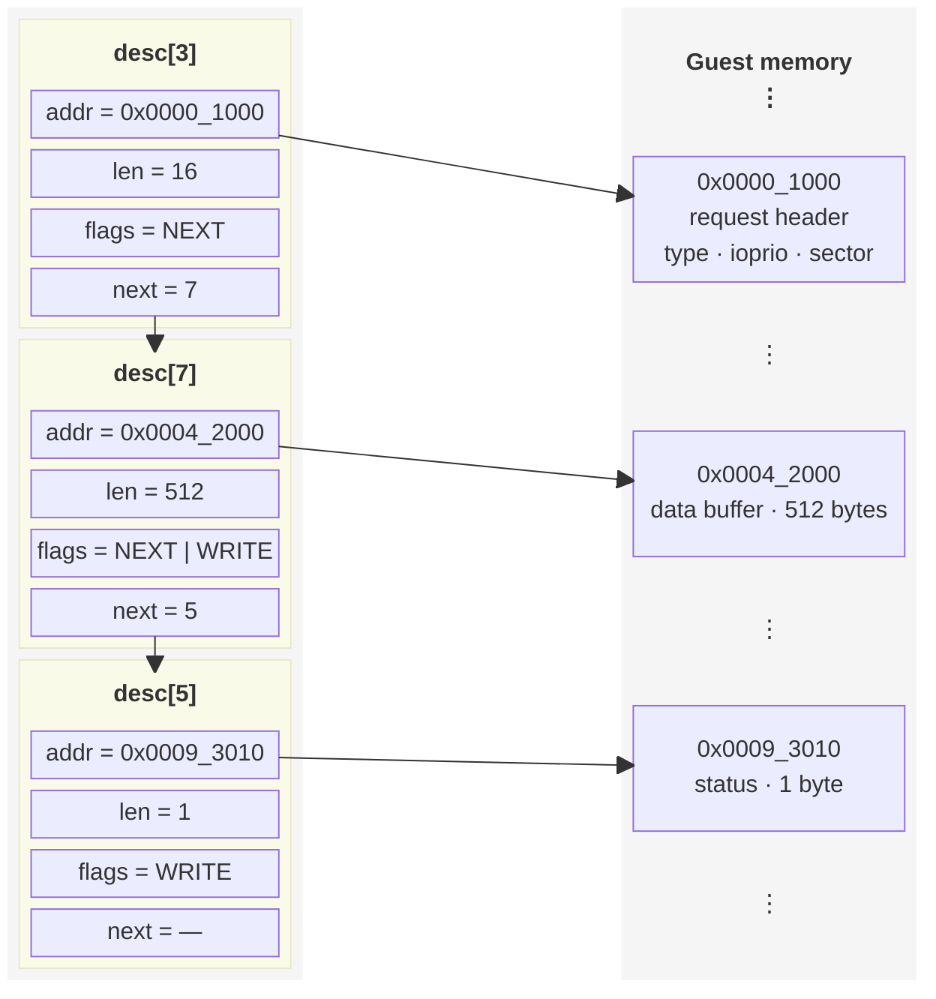

+++
title = 'Notes on X86 Virtio MMIO for a Block Device'
date = 2026-10-15T17:33:04+02:00
draft = false
+++

<p align="center">
  
</p>

## Introduction
The purpose of this article is simply to document my Virtio MMIO block device
implementation in Rust. Unlike Virtio with PCI as a transport layer, the MMIO
interface is relatively simple, although it lacks PCI-specific features such as
MSI-X. However, I think it is a good starting point for learning how Virtio
devices actually work under the hood.

## MMIO configuration

For the Linux kernel to start probing a Virtio device, we first need to
configure it. This can be done through the kernel command line by specifying the
amount of MMIO address space allocated for the device, its base address, and its
IRQ number:

```text
virtio_mmio.device=4K@0xd0000000:5
```

The MMIO address must correspond to a region reserved for device access in the
guest's physical address space. On x86, placing MMIO devices in the upper part
of the 32-bit address space is common, but the exact address depends on the
virtual machine's memory layout.

For example, my VMM uses the following memory layout constants:

```rs
const EBDA_START: u64 = 0x9fc00;
const HIMEM_START: u64 = 0x10_0000;
const MMIO_START: u64 = 0xc000_0000;
const HIGH_RAM_START: u64 = 0x1_0000_0000;
``` 

Here, MMIO_START marks the beginning of my reserved MMIO region. The example
device above is located at 0xd0000000, within that region.

## Virtio initialization

Having configured the MMIO device through the kernel command line, Linux can
start probing it. The driver first checks the magic value `virt` at the
device's MMIO base address (`0xd0000000`).

The following diagram illustrates the initial exchange between the guest and the
host:

```mermaid
sequenceDiagram
    autonumber
    participant G as Guest (Linux)
    participant H as Host (VMM)

    rect rgba(128,128,128,0.08)
    Note over G,H: Probe: identify the device
    H-->>G: MAGIC
    H-->>G: VERSION
    H-->>G: DEVICE_ID
    H-->>G: VENDOR_ID
    G->>H: STATUS (reset)
    end

    rect rgba(128,128,128,0.08)
    Note over G,H: Status handshake
    H-->>G: STATUS
    G->>H: STATUS |= ACKNOWLEDGE
    Note over G,H: Linux has seen the device
    H-->>G: STATUS
    G->>H: STATUS |= DRIVER
    Note over G,H: Kernel found a driver
    end

    rect rgba(128,128,128,0.08)
    Note over G,H: Feature negotiation
    G->>H: DEVICE_FEATURES_SEL = 0
    %% comment 10 right: SEL picks a 32-bit<br/>window: 0 → bits 0..31<br/>1 → bits 32..63
    H-->>G: DEVICE_FEATURES
    G->>H: DEVICE_FEATURES_SEL = 1
    H-->>G: DEVICE_FEATURES
    G->>H: DRIVER_FEATURES_SEL = 0
    %% comment 14 left: SEL picks a 32-bit<br/>window: 0 → bits 0..31<br/>1 → bits 32..63
    G->>H: DRIVER_FEATURES
    G->>H: DRIVER_FEATURES_SEL = 1
    G->>H: DRIVER_FEATURES
    H-->>G: STATUS
    G->>H: STATUS |= FEATURES_OK
    Note over G,H: Features configured
    H-->>G: STATUS
    end

    rect rgba(128,128,128,0.08)
    Note over G,H: Virtqueue setup
    Note over G,H: 1/0/0 default/read/poll queues
    G->>H: QUEUE_SEL = 0
    %% comment 21 right: selects the virtqueue<br/>the next QUEUE_*<br/>registers refer to
    H-->>G: QUEUE_READY
    H-->>G: QUEUE_NUM_MAX
    %% comment 23 left: max entries per ring<br/>(ring size, not the<br/>number of rings)
    G->>H: QUEUE_NUM
    %% comment 24 right: ring size the driver<br/>chose (≤ NUM_MAX)
    G->>H: QUEUE_DESC_LOW / HIGH
    %% comment 25 left: guest address of<br/>the descriptor table
    G->>H: QUEUE_AVAIL_LOW / HIGH
    %% comment 26 right: guest address of<br/>the avail ring
    G->>H: QUEUE_USED_LOW / HIGH
    %% comment 27 left: guest address of<br/>the used ring
    G->>H: QUEUE_READY = 1
    end

    rect rgba(128,128,128,0.08)
    Note over G,H: Device config space
    H-->>G: CONFIG_GENERATION
    %% comment 29 right: bumped on every config<br/>change; read before and<br/>after to catch torn reads
    H-->>G: CONFIG (capacity)
    %% comment 30 left: virtio_blk_config:<br/>capacity in sectors
    H-->>G: CONFIG
    %% comment 31 right: more virtio_blk_config<br/>fields
    H-->>G: CONFIG_GENERATION
    %% comment 32 left: unchanged → the config<br/>read is consistent
    Note over G,H: [vda] 32768 512-byte blocks
    end

    rect rgba(128,128,128,0.08)
    Note over G,H: Go live
    H-->>G: STATUS
    G->>H: STATUS |= DRIVER_OK
    Note over G,H: Driver is happy
    G->>H: QUEUE_NOTIFY
    Note over G,H: First I/O request kicked
    end
```



The first registers Linux reads are `VIRTIO_MMIO_MAGIC_VALUE`,
`VIRTIO_MMIO_VERSION`, `VIRTIO_MMIO_DEVICE_ID`, and `VIRTIO_MMIO_VENDOR_ID`. The
magic value is `0x74726976`, corresponding to the bytes `virt` in little-endian
order. The version is set to `2`, indicating the modern Virtio-MMIO transport,
and `VIRTIO_MMIO_DEVICE_ID` is set to `VIRTIO_ID_BLOCK`.

The vendor ID is an implementation-defined identifier; in my VMM, I use zero to
indicate that no specific vendor is identified.

The MMIO register definitions can be found in the Linux kernel source:

https://elixir.bootlin.com/linux/v7.1.3/source/include/uapi/linux/virtio_mmio.h

### Feature negotiation

During feature negotiation, `DEVICE_FEATURES_SEL` and `DRIVER_FEATURES_SEL`
select which 32-bit portion of the feature bitfield is accessed. Selector 0
covers bits 0–31, while selector 1 covers bits 32–63. The guest selects the
features it supports and the device must verify that the negotiated features
are supported.

For a block device, feature bits can be found on:

https://elixir.bootlin.com/linux/v7.1.3/source/include/uapi/linux/virtio_blk.h

Out of these I have selected only `VIRTIO_BLK_F_RO` (block device is read-only).

### Virtio Queue configuration

The guest then configures the `virtqueue` by selecting queue zero, reading its
maximum size, choosing a supported queue size and providing the guest physical
addresses of the descriptor table and the available and used rings. Setting
`QUEUE_READY` to 1 makes the queue ready for use.

### Finalization

At this point I have asked AI to make me a simple `rootfs` image for test. It
has done so using `mkfs.ext4` and Busybox. I added the `--disk` parameter to
my KVM Rust code and prepared the image file to be read at specific offsets.

Finally, Linux reads the device configuration, including the block device's
capacity. The capacity is expressed in 512-byte sectors. In this example, the
device exposes 32768 sectors, or 16 MiB. Note that this is set via the
`virtio_blk_config` struct.

Once initialization is complete and Linux sets `DRIVER_OK`, the device is ready
to process requests.

## Reading data from the disk

When we receive a write to `VIRTIO_MMIO_QUEUE_NOTIFY`, the guest has notified us
that there may be work to process on the selected `virtqueue`.

The notification itself does not contain the request. Instead, we need to
inspect the available ring to find the descriptor chains prepared by the guest.

My implementation focuses on a read-only block device. The guest can issue read
requests, but writes to the backing disk are not supported.

### Available ring

The guest informs us where the available ring is through VIRTIO_MMIO_QUEUE_AVAIL_HIGH and VIRTIO_MMIO_QUEUE_AVAIL_LOW. These registers provide the upper and lower halves of the guest physical address.

The available ring contains two fields, flags and idx, followed by an array of 16-bit descriptor-head indices.

The idx field is a wrapping 16-bit counter. We maintain our own last_avail_idx, which records the next available entry to process. Whenever the guest publishes new requests, it advances avail.idx. We process entries until last_avail_idx catches up with that value.

To find the next entry, we calculate the slot within the ring:

```rs
let avail_slot = (queue.last_avail_idx as u32 % queue.num) as usize;
```

We then read the descriptor-head index from that slot:

```rs
let head_idx = read_guest_ptr::<u16>(avail_ptr.add(
	0x4 // offset after flags and idx in vring_avail
		+ 0x2 * avail_slot // each entry in the slot is u16, i.e. has size 2
));
```

This index points into the descriptor table and the descriptor head can be
obtained with this helper function:

```rs
impl VringQueue {
    fn get_desc_head(&self, desc_idx: u16, _mem: &GuestMemory) -> vring_desc {
        let vring_desc_size = std::mem::size_of::<vring_desc>() as u64;
        let guest_addr = self.desc + (desc_idx as u64) * vring_desc_size;
        let desc_head_ptr = gpa_to_host(_mem, guest_addr, vring_desc_size as usize).unwrap();
        read_guest_ptr::<vring_desc>(desc_head_ptr)
    }
}
```

After processing a request, by iterating from `last_avail_idx` to `idx` field
we got in `vring_avail`, we increment `last_avail_idx` using wrapping
arithmetic:

```rs
queue.last_avail_idx = queue.last_avail_idx.wrapping_add(1);
```

The definition of `vring_avail` (along with `vring_desc`, `vring_used` and
`vring_used_elem`) can be found in:

https://elixir.bootlin.com/linux/v7.1.3/source/include/uapi/linux/virtio_ring.h

### Descriptor chain

The descriptor table is located at the address provided through `VIRTIO_MMIO_QUEUE_DESC_HIGH` and `VIRTIO_MMIO_QUEUE_DESC_LOW`. Each descriptor
contains an address, a length, flags and a next field:

```c
struct vring_desc {
	__virtio64 addr;
	__virtio32 len;
	__virtio16 flags;
	__virtio16 next;
};
```

The address points to a buffer in guest physical memory. If the descriptor has
the `NEXT` flag set, its next field identifies the next descriptor in the chain.

The following diagram illustrates a typical three-descriptor Virtio block request:



For a typical block request, the first descriptor points to a
`virtio_blk_outhdr` which contains the request type, priority and starting
sector. The second descriptor points to the data buffer and the third points to
a status byte.

However, a chain of exactly three descriptors is not a Virtio requirement. The
device must follow the descriptor flags and next fields rather than assume that
every request has the same number of descriptors.

The `WRITE` flag in the descriptor is particularly important: it means the
device is allowed to write to that buffer.

### The used ring

Whenever we complete a descriptor chain, we need to update the used ring,
located at the address provided through `VIRTIO_MMIO_QUEUE_USED_HIGH` and
`VIRTIO_MMIO_QUEUE_USED_LOW`.

The used ring contains `flags` and `idx`, followed by an array of
`virtq_used_elem entries`. Each entry contains two fields: `id`, the
descriptor-head index of the completed request (matching the index previously
obtained from the available ring) and `len`, the number of bytes written by the
device into the request's buffers.

To complete a request, the device writes a used-ring entry into the slot
selected by `used.idx`. The index is a wrapping 16-bit counter, just like
`avail.idx`. The guest maintains its own index to track which completions it has
already consumed.

### Interrupt

After publishing `used.idx`, the device may notify the guest by raising its
interrupt. Whether an interrupt is required depends on the configuration
negotiated with the guest. In my implementation, I set the Virtio-MMIO
interrupt-status bit for the `virtqueue` and update the virtual IRQ line.

The guest handles the interrupt by reading `VIRTIO_MMIO_INTERRUPT_STATUS` and
acknowledging the relevant bits by writing to `VIRTIO_MMIO_INTERRUPT_ACK`. The
VMM must implement these registers and the associated interrupt-line transitions
correctly.

## Example run

Following is the example run of Linux kernel with custom `rootfs` inside my
VMM:

<script src="https://asciinema.org/a/zgQkTwr26W5zpRG7.js" id="asciicast-zgQkTwr26W5zpRG7" async></script>

## Conclusion

The implementation of Virtio MMIO was a lot more complex than I expected.

I wondered why Virtio uses scatter-gather lists instead of a more simple,
contiguous buffer. The advantage is flexibility: a request can reference
multiple buffers in guest memory without requiring the guest to copy everything
into one contiguous region. The device traverses the descriptor chain and
processes the buffers in order.

This is my first implementation of the host-side handling of a basic block-read
request from the guest. In time, I plan to implement write requests, refactor
the code and explore other Virtio devices to extend the functionality of my VMM.

The implementation details can be found on my KVM Rust GitHub repo:

https://github.com/StjepanPoljak/hearth

Note that Virtio-MMIO Block code is implemented only for x86 for now.
