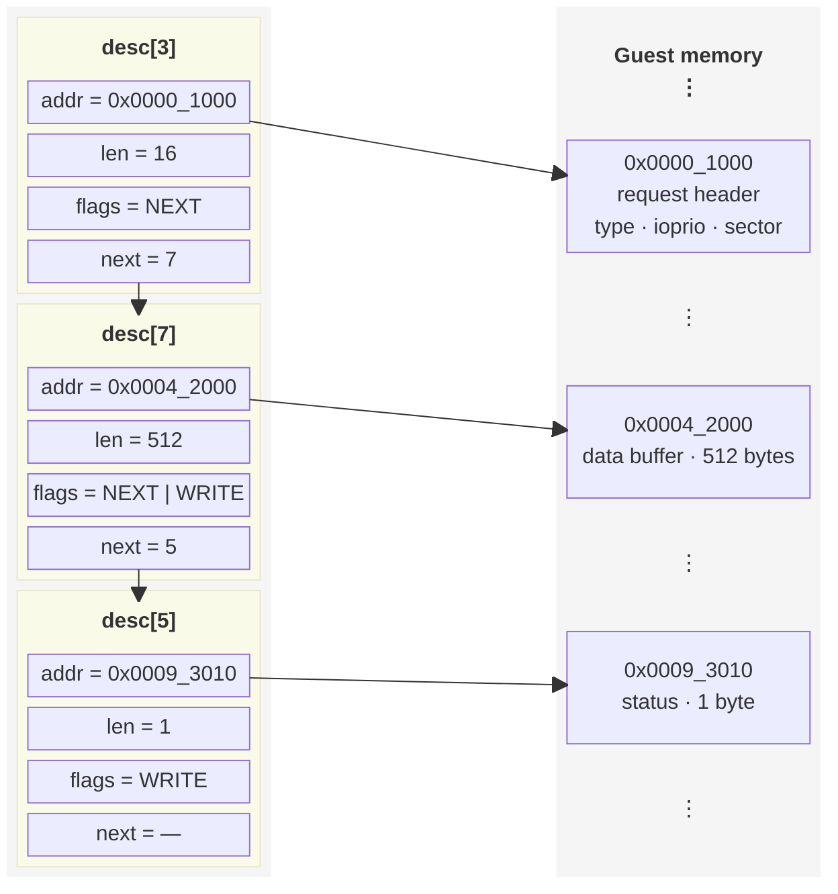

+++
title = 'Notes on X86 Virtio MMIO for a Block Device'
date = 2026-10-15T17:33:04+02:00
draft = true
+++

## Introduction

The purpose of this article is simply to document my `virtio` MMIO block device
implementation in Rust. Unlike `virtio` with PCI as a transport layer, the MMIO
interface is a lot simpler, although not as performant due to lack of MSI-X.
However, it is, I think, really good as a starting point to learn how the
`virtio` devices actually work under the hood.

## MMIO configuration

For the Linux kernel to start probing `virtio` device, we need to first
configure it. This can be done via the kernel command line, by providing amount
of MMIO memory allocated for the device, along with MMIO address and IRQ
number:

```text
virtio_mmio.device=4K@0xd0000000:5
```

Note that we should choose some MMIO base from the 3GiB to 4GiB range. This is
usual on x86 machines and we also configured our VM the same way:

```rs
const EBDA_START: u64 = 0x9fc00;
const HIMEM_START: u64 = 0x10_0000;
const MMIO_START: u64 = 0xc000_0000;
const HIGH_RAM_START: u64 = 0x1_0000_0000;
``` 

## Virtio initialization

Having configured the MMIO device in the kernel command line, Linux will start
probing the virtual device, provided that it finds the magic value `virt` on
MMIO base address. The following is a trace of initial exchange between the
guest and the host:

```mermaid
sequenceDiagram
    autonumber
    participant G as Guest (Linux virtio-mmio)
    participant H as Host (VMM)

    rect rgba(128,128,128,0.08)
    Note over G,H: Probe: identify the device
    H-->>G: MAGIC
    H-->>G: VERSION
    H-->>G: DEVICE_ID
    H-->>G: VENDOR_ID
    G->>H: STATUS (reset)
    end

    rect rgba(128,128,128,0.08)
    Note over G,H: Status handshake
    H-->>G: STATUS
    G->>H: STATUS |= ACKNOWLEDGE
    Note over G,H: Linux has seen the device
    H-->>G: STATUS
    G->>H: STATUS |= DRIVER
    Note over G,H: Kernel found a driver
    end

    rect rgba(128,128,128,0.08)
    Note over G,H: Feature negotiation
    G->>H: DEVICE_FEATURES_SEL = 0
    %% comment 10 right: SEL picks a 32-bit<br/>window: 0 → bits 0..31<br/>1 → bits 32..63
    H-->>G: DEVICE_FEATURES
    G->>H: DEVICE_FEATURES_SEL = 1
    H-->>G: DEVICE_FEATURES
    G->>H: DRIVER_FEATURES_SEL = 0
    %% comment 14 left: SEL picks a 32-bit<br/>window: 0 → bits 0..31<br/>1 → bits 32..63
    G->>H: DRIVER_FEATURES
    G->>H: DRIVER_FEATURES_SEL = 1
    G->>H: DRIVER_FEATURES
    H-->>G: STATUS
    G->>H: STATUS |= FEATURES_OK
    Note over G,H: Features configured
    H-->>G: STATUS
    end

    rect rgba(128,128,128,0.08)
    Note over G,H: Virtqueue setup
    Note over G,H: 1/0/0 default/read/poll queues
    G->>H: QUEUE_SEL = 0
    %% comment 21 right: selects the virtqueue<br/>the next QUEUE_*<br/>registers refer to
    H-->>G: QUEUE_READY
    H-->>G: QUEUE_NUM_MAX
    %% comment 23 left: max entries per ring<br/>(ring size, not the<br/>number of rings)
    G->>H: QUEUE_NUM
    %% comment 24 right: ring size the driver<br/>chose (≤ NUM_MAX)
    G->>H: QUEUE_DESC_LOW / HIGH
    %% comment 25 left: guest address of<br/>the descriptor table
    G->>H: QUEUE_AVAIL_LOW / HIGH
    %% comment 26 right: guest address of<br/>the avail ring
    G->>H: QUEUE_USED_LOW / HIGH
    %% comment 27 left: guest address of<br/>the used ring
    G->>H: QUEUE_READY = 1
    end

    rect rgba(128,128,128,0.08)
    Note over G,H: Device config space
    H-->>G: CONFIG_GENERATION
    %% comment 29 right: bumped on every config<br/>change; read before and<br/>after to catch torn reads
    H-->>G: CONFIG (capacity)
    %% comment 30 left: virtio_blk_config:<br/>capacity in sectors
    H-->>G: CONFIG
    %% comment 31 right: more virtio_blk_config<br/>fields
    H-->>G: CONFIG_GENERATION
    %% comment 32 left: unchanged → the config<br/>read is consistent
    Note over G,H: [vda] 32768 512-byte blocks (16 MiB)
    end

    rect rgba(128,128,128,0.08)
    Note over G,H: Go live
    H-->>G: STATUS
    G->>H: STATUS |= DRIVER_OK
    Note over G,H: Driver is happy
    G->>H: QUEUE_NOTIFY
    Note over G,H: First I/O request kicked
    end
```



As noted before, first thing it probes is `virt` magic value, followed by
`VIRTIO_MMIO_VERSION` (here it is set to `2`), `VIRTIO_MMIO_DEVICE_ID`
(`VIRTIO_ID_BLOCK` which identifies it as a block device) and
`VIRTIO_MMIO_VENDOR_ID` which is simply set to "none". These MMIO macro
definitions can be located in:

https://elixir.bootlin.com/linux/v7.1.3/source/include/uapi/linux/virtio_mmio.h


## Descriptor chain

**Descriptor chain for one read request.** `next` is an index into the
descriptor table, so a chain can use any free entries, in any order.


