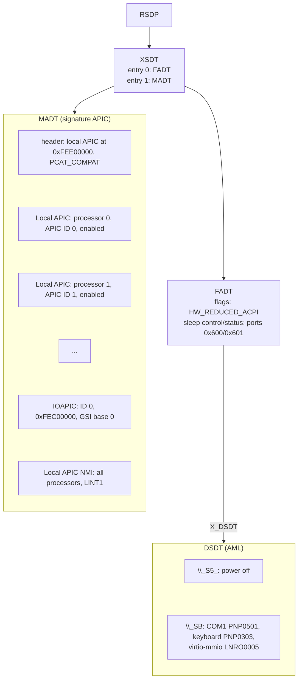
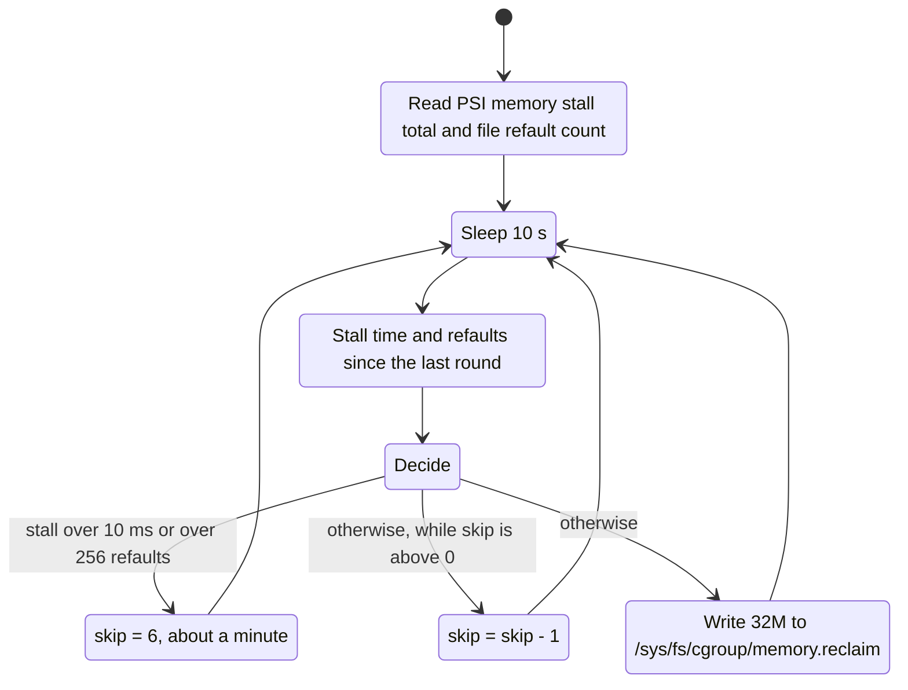

+++
title = 'Optimizing KVM Memory Usage with Hearth: From Virtio Balloon to Linux Reclaim'
date = 2026-11-18T14:54:15+01:00
series = ["Hearth"]
series_order = 13
tags = ["KVM", "Virtio Balloon", "Memory Reclaim", "DAMON", "Rust", "k3s"]
featureimage = "images/hearth-memory.drawio.svg"
+++

<p align="center">
  
</p>

## Motivation

Previously, we have learned about
[EPT](../master-linux-kvm-paging-with-hearth-part1) and [shadow
paging](../master-linux-kvm-paging-with-hearth-part2) when talking about
KVM. We tried running Doom and a custom benchmark script to see how
virtualization performance is affected by `ept` and `tdp_mmu` options in
the `kvm_intel` and `kvm` kernel modules, respectively.

To test and expand Hearth's capabilities further, I decided to try
something heavier: k3s.

## Prerequisites for k3s

To even be able to run k3s properly, I also needed to have Hearth
support SMP. Separating each vCPU into its own thread was relatively
easy. The more problematic part was ACPI tables, not because they were
hard to understand (they were not), but because Hearth lacked the
necessary infrastructure. Networking was another thing.

### SMP and ACPI

In my x86 PVH boot code (read [this](../notes-on-x86-pvh-boot)), I
was adding a lot of tables to guest memory. Originally, I just did this
manually, putting each field into a separate variable and copying
everything to guest memory. This was not maintainable, even with AI
helping me out.

I decided I needed to implement a bump allocator first. After that, the
code for allocating space and adding data structures to guest memory
became much simpler. Adding ACPI tables, including MADT and FADT, was
then a piece of cake.

The resulting ACPI layout looks like this:



### Virtio net

Obviously, k3s needs network capabilities, so I needed to implement a
virtio net interface. This turned out to be rather straightforward, as
the infrastructure I created for [virtio
block](../notes-on-x86-virtio-blk.md) could be reused almost entirely.

I needed to handle two virtqueues (one for TX and one for RX) and also
add a TAP device, which is handled via a script because it requires
`sudo`.

## Building k3s

Since Alpine already packages k3s, I decided to create a Dockerfile that
would build the guest environment cleanly. However, k3s also requires
some additional files in the guest root filesystem, which Docker handles
a bit awkwardly. So these are added at a later stage.

This is, however, a topic on its own.

## Running k3s

The first runs of k3s revealed something concerning: a lot of memory was
being used, and once it grew to 1.59 GB, it never shrank.

First, I tried manually dropping caches in the guest:

``` sh
echo 3 > /proc/sys/vm/drop_caches
```

This freed 393 MB in the guest, but on the host, Hearth was still using 1.59 GB
of guest RAM. The host RSS remained unchanged.

### The reason of high RSS

When we call `mmap` to allocate guest RAM, we reserve a virtual address
range in the host process. The actual physical memory backing those
pages is allocated on demand, when the guest writes to them.

We saw this happen as a page fault in previous articles. Only then does
the host kernel allocate physical memory to back the corresponding part
of the mapping.

The host kernel manages these pages and can reclaim them when
appropriate. In the guest, however, things are different. The guest
kernel manages its own physical memory and knows which pages are free,
but the host kernel has no inherent knowledge of that.

Even if the guest considers a page free, its backing memory on the host
can remain allocated. The host needs some way of knowing that the guest
no longer needs those pages.

### Virtio balloon

This is where virtio balloon comes in. It is a virtual device through
which the guest and host can coordinate memory reclamation.

There are two mechanisms worth mentioning:

-   **Inflate and deflate:** The host sets a target through the device's
    configuration space. The guest driver allocates pages and places
    them on the inflate queue. The host can then reclaim their backing
    memory. Deflation returns those pages to the guest. This requires a
    host-side policy deciding how much memory to reclaim.

-   **Free page reporting** (`VIRTIO_BALLOON_F_REPORTING`): The guest reports
    pages that are already free to the host. This can happen independently of a
	host-side reclamation target. This is the mechanism I implemented.

Hearth handles the report immediately when the guest notifies the virtqueue,
calling `madvise(MADV_DONTNEED)` before returning control to the guest:

```rs
impl VirtioBalloon {
	pub fn new() -> Self {
        VirtioBalloon { reported: 0 }
    }

    fn discard(&mut self, block: &mut [u8]) {
        let addr = block.as_mut_ptr() as usize;
        let page = PAGE_SIZE as usize;
        if addr % page != 0 || block.len() % page != 0 || block.is_empty() {
            return;
        }
        let ret = unsafe { libc::madvise(addr as *mut libc::c_void, block.len(), libc::MADV_DONTNEED) };
        if ret == 0 {
            self.reported += block.len() as u64;
        }
    }
}
```

Then, when processing the descriptor chain, we call the `discard` method:

```rs
    fn process(&mut self, queue: u32, chain: &mut DescChain) -> Result<u32, GuestError> {
        if queue == REPORTING_QUEUE {
            for block in chain.write_buf.iter_mut() {
                self.discard(block);
            }
        }
        Ok(0)
    }
```

### Reclaiming in the guest

Free page reporting only gives back what the guest already considers free. The
guest kernel, however, can keep its page cache until memory pressure forces it
to reclaim those pages.

I therefore added a small script in the guest, which asks the kernel to reclaim
memory in small increments:

```sh
#!/bin/sh

INTERVAL=${INTERVAL:-10}
STEP=${STEP:-32M}
PSI_MAX_US=${PSI_MAX_US:-10000}         # 0.1% of a 10 s round
REFAULT_MAX=${REFAULT_MAX:-256}         # pages per round, 1M
BACKOFF=${BACKOFF:-6}

psi() { sed -n 's/^some .*total=//p' /proc/pressure/memory; }
refaults() { sed -n 's/^workingset_refault_file //p' /proc/vmstat; }

p0=$(psi); r0=$(refaults); skip=0
while sleep "$INTERVAL"; do
    p1=$(psi); r1=$(refaults)
    dp=$((p1 - p0)); dr=$((r1 - r0)); p0=$p1; r0=$r1
    if [ $dp -gt $PSI_MAX_US ] || [ $dr -gt $REFAULT_MAX ]; then
        skip=$BACKOFF
        echo "$(date +%s) back off: psi ${dp}us refaults $dr"
    elif [ $skip -gt 0 ]; then
        skip=$((skip - 1))
    else
        echo "$STEP" > /sys/fs/cgroup/memory.reclaim 2>/dev/null
        echo "$(date +%s) reclaim $STEP: $?"
    fi
done
```

It then monitors the consequences and backs off as soon as the guest shows signs
that it needs the reclaimed memory. The algorithm looks like this:



The two signals that tell us what the guest pays for this reclamation:

- **PSI** measures how much tasks are delayed when waiting for memory. For
  example, if a process needs to allocate memory when memory is already low, it
  may have to wait until kernel reclaims more memory. Here, we monitor the
  increase in cumulative memory stall time between sampling intervals; e.g. if
  it increases by 10 ms over a 10-second interval, that represents 0.1% of
  elapsed time.

- The **refault** counter tells us how often evicted file-cache pages are
  accessed again. It provides an indication that reclamation may be evicting
  useful cache pages. For example, we may have read a file whose contents were
  cached, but when re-reading the cache was gone and the page had to be re-read
  from the disk.

Also note that writing to the root cgroup's `memory.reclaim` makes the kernel
reclaim memory from the whole guest.

## Benchmarks

I measured an idle k3s node with 2 vCPUs and 2 GB of RAM for 30 minutes after
boot. Hearth's `--balloon` option was enabled where applicable. Each configuration was run once. The table shows the final Hearth RSS sample at 30 minutes.

### DAMON

I compared the script with `DAMON_RECLAIM`, which uses DAMON to identify memory
regions that have not been accessed and reclaim them. I tested both its default
configuration and a configuration with 1000 minimum regions and 2000 maximum
regions. The script was also tested with a guest kernel using the multi-gen LRU
(`CONFIG_LRU_GEN`):

| Setup | Hearth's RSS | Re-read from disk | Peak memory PSI (`some avg60`) |
|---|---:|---:|---:|
| nothing | 2000 MB | 0 | 0 |
| `DAMON_RECLAIM`, 10 regions (default) | 2004 MB | 0 | 0 |
| `DAMON_RECLAIM`, 1000 regions | 1259 MB | 634 MB, still rising | 0 |
| reclaim script, classic LRU | 1064 MB | 263 MB, settled | 0.87% |
| reclaim script, multi-gen LRU | 982 MB | 331 MB, still rising | 3.22% |

The difference between `DAMON_RECLAIM`'s default configuration and the one with
more regions is particularly interesting. With the default minimum of 10
regions, a region could cover roughly 200 MB. This mixed hot and cold pages,
and no region was considered idle for the required 120 seconds. Consequently,
nothing was reclaimed.

With 1000 minimum regions, DAMON could identify smaller regions with similar
access patterns. A separate monitoring-only run, using a 5 ms sampling interval,
identified about 563 MB of page cache idle for at least 120 seconds.

### Reclaim script results

The reclaim script achieved an even lower RSS, although at the cost of some
refaults and memory stalls. Interestingly, the multi-gen LRU configuration
achieved the lowest RSS, but also had the highest memory stall percentage.

With only one run per configuration and an idle workload, I wouldn't draw any
strong conclusions from these numbers, but they are a good starting point.

## Final thoughts

Getting k3s running on Hearth required quite a few additions, but memory
reclamation turned out to be the most interesting part. I wanted to see how far
I could push memory usage down without making the guest suffer too much.

There is still plenty to explore and test, as k3s is far more complex than a
simple bare-metal Doom guest with a bump allocator. Also, what we run in k3s
should also influence our findings.

Virtio Balloon implementation in Rust can be found in Hearth GitHub repository:

https://github.com/StjepanPoljak/Hearth/blob/main/src/virtio/balloon.rs

The k3s guest setup and reclaim script can be found in the following folder:

https://github.com/StjepanPoljak/Hearth/blob/main/guests/k3s/
